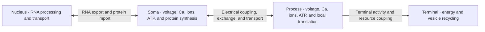

# Scientific and computational model

Codex, 2026-11-13. [Home](../README.md).

The model couples a soma, a process and selected terminal pools, with molecular and nuclear subsystems. A common state vector, original reference baseline and checkpoint carry the physical history. It is a compartmental conditional model, not an anatomical reconstruction of a patient's neuron.

## Compartments and coupling

The process represents an axon or neurite in the supported scenarios. The terminal has selected energy and vesicle pools. The redox scenario adds finite nutrient and glutathione exchange between soma and process and models detailed NADPH supply in the process.

The diagram shows the coarse organization of the model. Compartment volumes and exchange laws are specified by the selected scenario.

## Conservation and coupling

The generic pool equation is d(amount)/dt = sum(inputs) − sum(outputs). Concentration changes require the appropriate accessible volume; equal numeric concentrations in different compartments need not be equal amounts. Electrical changes follow membrane current balance with the stored conductances, capacitances and driving forces. A positive outward current is not interchangeable with a positive inward concentration flux; source modules define these conventions.

The Na/K pump transports 3 Na outward and 2 K inward per ATP. The integrated host is the common owner of these ion and ATP fluxes. Adding a source assay or observation does not create a new membrane flux. ATP/ADP/AMP, creatine/phosphocreatine, guanylate pools, translation resources and RNA/protein inventories have explicit accounting at the implemented level of detail. Some counters and observed totals are projections of shared states, not additional physical molecules.

| Component | Primary source entry |
|---|---|
| Public facade | `data/neuron-model/model_api.py` |
| Composition and state ownership | `data/neuron-model/integrated_neuron.py` |
| State/checkpoint contract | `data/neuron-model/model_contracts.py` and `state_layout_v1.json` |
| Full integration and coupled right-hand side | `data/2026-10-28-takeuchi-balaji/adaptive_recycling_neuron.py` |
| Current candidate construction | `data/2026-11-13-joint-kcnq-pump-v2/options.py` |
| Candidate grid | `data/2026-11-13-joint-kcnq-pump-v2/declared_candidates.json` |

The implementation is the exact equation-level reference; this document summarizes its structure, not every thousands-state equation. State labels are returned in `columns.json` by the example. Analysis labels disambiguate RNA and protein; backend ordering and checkpoint schema are preserved.

## Mechanisms and evidence

| Mechanism | Equation or implementation | Active parameters and evidence |
| --- | --- | --- |
| Membrane voltage, Na/K/Cl, and Na/K pumping | Membrane current balances, ion fluxes, and 3 Na out / 2 K in per pump cycle. [Coupled ion and energy implementation](../data/2026-10-26-nak-source-calibration/energetic_neuron.py) | Reference profiles use fitted electrical parameters. The C08 KCNQ conductance (0.05 nS), initial passive Na/K share (0.5), and pump alpha3 capacity fraction (0.9) are scenario choices. [C08 declaration](../data/2026-11-13-joint-kcnq-pump-v2/declared_candidates.json) · [KCNQ evidence](../data/2026-11-12-absolute-kcnq/README.md) |
| Ca buffering and PMCA pumping | Ca transport, buffering, and PMCA flux are linked to compartment volume and ATP accounting. [Calcium model and source discussion](../data/2026-10-19-calcium-buffer-calibration/README.md) · [Spatial PMCA implementation](../data/2026-10-25-pmca-spatial-model/spatial_pmca.py) | Experiments in other cell types constrain mechanisms. Transfer of kinetics, accessible volumes, and active pump densities remains conditional. [Assumptions](ASSUMPTIONS.md) |
| ATP supply and terminal recycling | ATP and phosphocreatine pools balance production and demand. Terminal recycling couples vesicle turnover and energy use. [Integrated right-hand side](../data/2026-10-28-takeuchi-balaji/adaptive_recycling_neuron.py) · [Terminal energy evidence](../data/2026-10-26-geometry-mito-nmj/README.md) | Biochemical stoichiometry and source assays guide the accounting. Cell-specific flux capacities and terminal behavior remain scenario-dependent. [Assumptions](ASSUMPTIONS.md) |
| Nuclear transport, RNA, and protein maintenance | The shared state vector carries transcript transport, translation queues, and protein turnover. [State ownership and composition](../data/neuron-model/integrated_neuron.py) | Parameters include source-system turnover estimates, transfer assumptions, and scenario pools. [RP transcript evidence](../data/2026-11-04-human-MN-rp-mrna/README.md) · [Parameter inventory](../parameters/README.md) |
| Optional amino-acid, GSH, and NADPH supply | Finite exchange and recycling, with a pentose phosphate pathway contribution to NADPH. [Redox equations](../data/2026-11-15-aa-gsh-nadph/supply.py) | G6PD inhibition at 9 µM is anchored to a purified human-enzyme measurement under assay conditions. Delivery at 0.1 µM/s and GSH recovery at 0.5 are scenario choices. [Active values, ranges, and evidence](../parameters/redox_assumptions.json) |

Each run writes its resolved values to `config.json` and biological qualifications to `provenance.json`. The parameter inventory also contains historical search grids. Use the resolved configuration to identify active values for a specific run.

## Units and protocols

Public example schedules use seconds; membrane voltage uses mV and applied electrical current pA. Conductance inputs include nS and ionic/molecular concentrations commonly use micromolar. Some historical isolated electrical routines use milliseconds and some molecular states have reference normalization. Never infer a unit merely from a numeric array. Each result includes the configuration and labels, and the registry explicitly marks unresolved units.

The current C08 scenario uses inherited reference-bath and temperature assumptions. The same name as a published cell line does not establish a fully matched recording protocol. In particular, nine historical spike-count targets are regression references; the Selvaraj 50-pA target is not a published experimental measurement.

## Scientific limits

No common healthy human steady state has been established. Some long protocols maintain ATP while retaining a potassium deficit. PMCA-associated proton equivalents were diagnosed, but explicit pH buffering/acid extrusion is incomplete in this snapshot. A finite numerical solution and small ledger residual cannot prove that this missing biological mechanism is represented. Human calibration, independent discrimination of hypotheses and prediction of interventions remain open.
