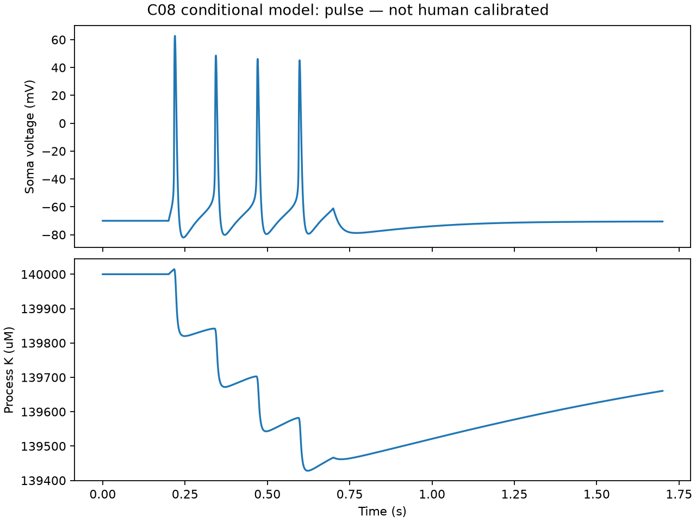

# Validation of the publication candidate

Codex, 2026-11-13. [Home](../README.md) · [Machine-readable evidence](../provenance/validation_codex.json).

This export was executed using a newly created Python 3.12 virtual environment, with packages installed from the pinned requirements. Python isolated mode excluded the workstation PYTHONPATH. Read guards rejected access to the original research directory and its separate tools directory. Simulation network access was blocked. Generated outputs and compilation caches were written to a separate audit directory.

| Check | Observed result |
|---|---|
| Full-state C08/Burley 20-ms smoke | 4425 states, 80 returned samples; finite |
| Source-versus-export full trajectory | Identical time grid and maximum absolute state difference **0.0** |
| Largest reported smoke balance residual | 1.55379e-10; units are specified per individual check, not one shared unit |
| Checkpoint continuation 20→40 ms | Exact starting state; maximum endpoint difference 3.48504e-08 versus uninterrupted integration, within the stated tolerance |
| C08/Burley 25-pA pulse | **4** spikes during the step; all states finite |
| Largest reported pulse balance residual | 2.837e-09 |
| Original source files | 254 source/input files hash-checked; none changed by export |

Measured elapsed time to the smoke result was about 163 s, excluding the subsequent restart comparison/plot. The pulse took about 673 s on this workstation. Cold compilation, hardware and disk speed affect these times. Pulse output can involve hundreds of MB of in-memory arrays; allow several GB of free RAM. The full extended protocols are substantially more expensive and were not rerun here.

The unchanged source reference was captured before packaging. Export adaptations defer two optional NEURON initialization paths; all existing scientific function bodies were compared by AST after excluding the added initializer call. Two metadata files have contact email strings omitted; numeric values and structure are preserved. Hashes of original and exported versions are recorded separately.

A second relocated copy, including the sanitized metadata, passed smoke and restart checks. All 4425-state samples exactly matched the source reference. Access to the original project, tools and first export directory was blocked. The 224 runtime-read files and both public entry helpers match the final package by SHA-256. Final verification recorded 2026-11-14 (Europe/Moscow); preparation began 2026-11-13.

## License/documentation update, 2026-11-14

Version `0.1.1-prepublication` changes licensing, mission, documentation and metadata only. All model source, runtime inputs, dependency pins, verification scripts and numerical reference files are byte-identical to the tested `0.1.0-prepublication` snapshot. Numerical tests were not rerun; the results above describe that unchanged executable snapshot. Package hashes, documentation links and archive contents were verified again.

Version `0.1.2` adds public repository metadata and download instructions only. The same executable files and numerical references remain byte-identical; no new biological validation is claimed.

Version **0.2.0** changes licensing/documentation and restores two third-party notice files. All existing Python source, runtime numerical inputs, dependency pins and numerical references are byte-identical to 0.1.2. No numerical simulations were rerun for this change; the earlier results apply to that unchanged executable snapshot.

## Practical limits

- This is a computational reproduction check, not human calibration or proof of treatment efficacy.
- Selected long-run and nine-condition panels remain **historical evidence**, not fresh tests of every release pathway.
- Windows Python 3.12 is tested; other platforms are not certified.
- The default quick example integrates a brief interval. It cannot establish long-term stability or fix the unresolved potassium/PMCA/pH issues.
- Package scanning checks known sensitive patterns and excludes private source categories. It does not substitute for the owner's final authorship, rights and publication review.

Run `verify_package_codex.py` for hashes, syntax and documentation links; run `tests/check_output_codex.py OUTPUT_DIR` after a numerical example. The reference tolerances are numerical regression criteria, not biological confidence intervals.
